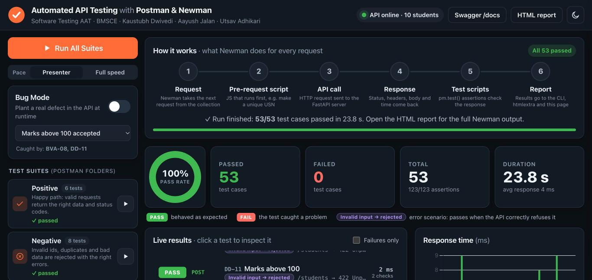
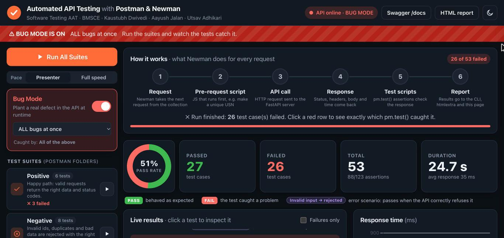
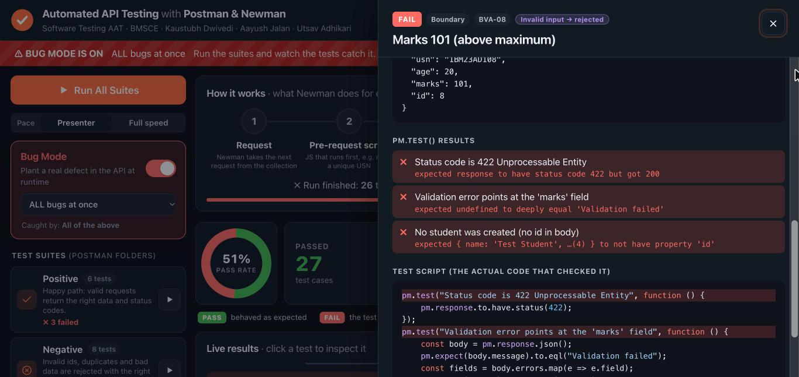
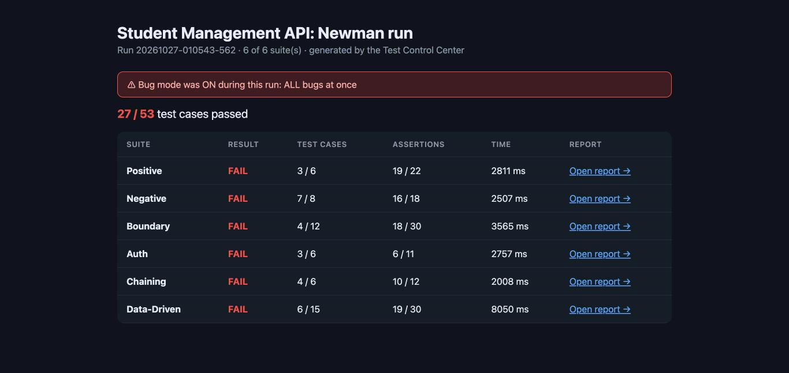

# Automated API Testing with Postman & Newman

**A REST API, a 53-case Postman test suite, and a live web dashboard that runs it with Newman and shows every request and assertion as it happens.**




---

## Contents

- [About](#about)
- [Features](#features)
- [Screenshots](#screenshots)
- [How it works](#how-it-works)
- [Test suites](#test-suites)
- [Planted bugs](#planted-bugs)
- [Quick start](#quick-start)
- [Running in the Postman app](#running-in-the-postman-app)
- [CLI usage](#cli-usage)
- [Project structure](#project-structure)
- [Tech stack](#tech-stack)

---

## About

This project is our **Software Testing Alternative Assessment Tool (AAT)** at **BMS College of Engineering**.
Our registered topic is *Automated API Testing with Postman and Newman*.

Other groups covered unit testing (JUnit), mutation testing (PIT) and UI testing (Selenium, Playwright).
This project covers the layer in between: the **REST API**. We test it at the HTTP level with Postman collections
and run them automatically with Newman.

**Team**

| Name |
|------|
| Kaustubh Dwivedi |
| Aayush Jalan |
| Utsav Adhikari |

The project has three parts:

1. **System under test.** `app/student_api.py` is a FastAPI *Student Management API* with validation rules,
   bearer-token auth, the usual error codes, and seven bugs we can switch on at runtime.
2. **Test suite.** `postman/` holds a Postman v2.1 collection: **53 test cases** and **123 assertions** in six folders,
   plus an environment and a CSV data file.
3. **Test Control Center.** A web dashboard that runs the suites through the Newman library and **streams results live**
   to the browser, so the audience can see each test run without watching a terminal.

---

## Features

**Dashboard (Test Control Center)**
- **One-click runs.** *Run All Suites*, or the ▶ button on any single suite card.
- **Live results feed.** Each request appears as it finishes, with PASS/FAIL, method, endpoint and response time.
- **Pipeline view.** Six steps (Request → Pre-request script → API call → Response → Test scripts → Report) light up as Newman processes each request.
- **Detail drawer.** Click any test to see the request, the response, each `pm.test()` result and the test script itself. The lines that failed are highlighted.
- **Summary.** Passed / failed / total counters, assertion count, a pass-rate donut and a response-time bar chart.
- **Test case table.** ID | Type | Test case | Input | Expected | Actual | Result. You can filter it (All / Passed / Failed) and **export it to CSV**.
- **"Invalid input → rejected" badge.** Marks the 26 error-scenario tests that pass *because* the API correctly refuses bad input. A legend explains each badge.
- **Bug Mode.** Plant one of seven defects (or all at once) in the running API. A warning banner appears, and a hint shows which tests should catch the bug.
- **Setup steps** (`[setup] Reset data`) appear as subtle grey lines and are **not** counted as tests.
- **HTML reports.** Each run writes one Newman *htmlextra* report per suite, plus an index page that links them.
- **Run history** of the last 20 runs, with a link to each run's report.
- **Presenter pace** (a 250 ms pause between requests) or full speed. Dark/light theme. Works offline, because Chart.js is served locally.
- If you refresh the page, it shows the latest run again. If a run is still going, it reconnects to it.

**Test suite**
- Assertions check the status code, body values, error messages, response time, and a JSON schema.
- Pre-request scripts generate unique USNs.
- Request chaining with `pm.environment.set("createdId", …)` and `{{createdId}}`.
- Data-driven testing with `students.csv` (15 rows, each with its own `expected_status`).
- Every suite starts by resetting the data, so suites are independent and can run in any order.

**Tooling**
- `./start.sh`: installs missing dependencies, starts the server, and opens the browser. If port 8000 is taken, it **picks the next free port** (it never kills another process).
- `./run_tests.sh` and `./run_bug_demo.sh` run the same suites with the Newman CLI, for CI or as a backup.

---

## Screenshots

| | |
|---|---|
|  |  |
| **Run All, normal mode:** 53/53 passed | **Bug Mode → "ALL bugs at once":** 26 tests catch the defects |
|  |  |
| **Detail drawer:** each `pm.test()` result, with the failing lines highlighted | **HTML report index:** links one htmlextra report per suite |

---

## How it works

### What Newman does for every request

```
 1. Request ─▶ 2. Pre-request script ─▶ 3. API call ─▶ 4. Response ─▶ 5. Test scripts ─▶ 6. Report
 (next item     (JS before sending,       (HTTP to the    (status, body,   (pm.test()          (CLI, htmlextra,
  in the         e.g. a random USN)        FastAPI app)    headers, time)   assertions)         this dashboard)
  collection)
```

The dashboard's pipeline view shows these same six steps, highlighting the active one as each request runs.

### How the live dashboard is wired

```
Browser ──POST /control/run──▶ FastAPI ──spawns──▶ node runner/run_newman.js ──HTTP──▶ Student API
   ▲                             │                    │  newman.run(...)
   │                             │                    │    .on('beforeRequest' | 'request' | 'assertion' | 'item' | 'done')
   └──── Server-Sent Events ◀────┴──── JSON lines ◀───┘
```

1. `POST /control/run {"suite": "all"}` creates a run. FastAPI starts `runner/run_newman.js` once per suite.
2. The runner uses the **Newman Node library** and listens to its events. It prints each event as **one JSON line**:
   `phase` (which pipeline step is active), `result` (request, response and assertions for one item), and `done` (totals).
3. FastAPI reads those lines as they arrive and forwards them to the browser with **Server-Sent Events**
   (`GET /control/stream/{runId}`).
4. The page queues the events, animates the pipeline, and updates the feed, counters, charts and table.
   DOM writes are batched per animation frame and charts redraw at most every 150 ms, so the page stays smooth.

**Control endpoints:** `GET /control/suites`, `POST /control/run`, `GET /control/status`, `GET /control/stream/{runId}`,
`GET|POST /control/bug-mode`, `GET /control/history`, `GET /control/report`.

### The API under test

| Method | Path | Auth | Success | Errors |
|--------|------|------|---------|--------|
| GET | `/health` | none | 200 | |
| POST | `/reset` | none | 200 (restores 3 seed students) | |
| GET | `/students` | none | 200 | |
| GET | `/students/{id}` | none | 200 | 404, 422 |
| POST | `/students` | Bearer | 201 | 401, 403, 409, 422 |
| PUT | `/students/{id}` | Bearer | 200 | 401, 403, 404, 409, 422 |
| DELETE | `/students/{id}` | Bearer | 200 | 401, 403, 404 |

Validation: `name` 1–50 chars · `usn` like `1BM23AD028` · `age` 17–30 · `marks` 0–100.
Auth: `Authorization: Bearer demo-token-123` (a fixed demo token for this local test API). No header gives **401**, a wrong token gives **403**.
Storage is in memory. The interactive Swagger docs are at `/docs`.

---

## Test suites

| Folder | Cases | Technique | Examples |
|--------|------:|-----------|----------|
| **Positive** | 6 | Happy path, JSON schema, response time | list, get, create, update, delete |
| **Negative** | 8 | Error handling: 404 / 409 / 422 and their messages | unknown id, duplicate USN, bad USN format, wrong type |
| **Boundary** | 12 | Boundary Value Analysis | age 16/17/30/31, marks −1/0/100/101, name 0/1/50/51 chars |
| **Auth** | 6 | Bearer-token security | no token → 401, wrong token → 403, valid token, public GET |
| **Chaining** | 6 | Request chaining | create → save `createdId` → get → update → verify → delete → 404 |
| **Data-Driven** | 15 | One request × CSV rows | `postman/data/students.csv` with `expected_status` per row |
| **Total** | **53** | **123 assertions** | |

Each folder also starts with a `[setup] Reset data` request, which is not counted as a test.
The full table, with inputs, expected and actual results, is in **[TEST_CASES.md](TEST_CASES.md)**.

---

## Planted bugs

Each bug is **one marked line** in `app/student_api.py` (search for `<-- BUG`). You can toggle it from the dashboard or with `./run_bug_demo.sh <bug>`.
Each bug fails only the tests that check the rule it breaks. We verified this by running all six suites under every bug.

| Bug | What goes wrong | Caught by |
|-----|-----------------|-----------|
| `marks_over_100` | Marks above 100 accepted | BVA-08, DD-11 |
| `wrong_status` | `POST /students` returns 200 instead of 201 | POS-04, BVA-02/03/06/07/10/11, CHN-01, DD-01…DD-07 (every create) |
| `auth_bypass` | A wrong bearer token is accepted | AUTH-02, AUTH-04 |
| `name_length` | Names over 50 characters accepted | BVA-12 |
| `duplicate_usn` | Duplicate USN allowed (no 409) | NEG-04, DD-15 |
| `slow_response` | `GET /students` takes ~800 ms | POS-02, AUTH-06 (response-time checks) |
| `wrong_body` | `GET /students/{id}` returns `student_age` instead of `age` | POS-03, CHN-02 (JSON schema checks) |
| `all` | Every bug above at once | all 26 tests above (27/53 pass) |

---

## Quick start

**Requirements:** macOS, Python 3.9+ and Node.js 18+. (`start.sh` uses the macOS `open` command to launch the browser.)

```bash
git clone https://github.com/kaustubh-commits/software-testing-postman-newman.git
cd software-testing-postman-newman
./start.sh
```

`start.sh` does the following:
1. creates `.venv` and installs FastAPI + Uvicorn, if they are missing
2. runs `npm install` for `newman`, `newman-reporter-htmlextra` and `chart.js`, if they are missing
3. starts the server on **port 8000**. If 8000 is used by another program it tries 8001, 8002 and so on. If the app is already running, it just opens the browser.
4. opens the dashboard

| URL | What |
|-----|------|
| `http://localhost:8000/` | Test Control Center |
| `http://localhost:8000/docs` | Swagger UI |
| `http://localhost:8000/control/report` | Report index of the latest run |

Stop the server with **Ctrl+C**.

---

## Running in the Postman app

1. Start the server (`./start.sh`).
2. In Postman, click **Import** and add both files:
   `postman/Student_Management_API.postman_collection.json` and `postman/Local.postman_environment.json`.
3. In the environment dropdown, select **Student API - Local**.
4. Send any request, for example *Positive → POS-03 Get student by id*, and open the **Test Results** tab.
5. To run a whole folder, right-click it → **Run folder**.
6. For **Data-Driven**, choose `postman/data/students.csv` with **Select File** in the Runner (15 iterations).
   Without the CSV, its test is skipped instead of failing.

> If the server runs on another port, change `baseUrl` in the environment.

---

## CLI usage

```bash
./run_tests.sh                    # all six suites with the Newman CLI
./run_tests.sh Boundary Auth      # selected suites
./run_bug_demo.sh                 # marks_over_100 → Boundary suite → bug mode switched off again
./run_bug_demo.sh auth_bypass     # any bug: wrong_status, auth_bypass, name_length,
                                  #   duplicate_usn, slow_response, wrong_body, all
```

These scripts reuse the running server, or start a temporary one if none is running.
Reports go to `reports/cli/<timestamp>/index.html`. The exit code is non-zero if any test fails.

The Newman command itself, the same one you would put in a CI pipeline:

```bash
npx newman run postman/Student_Management_API.postman_collection.json \
    -e postman/Local.postman_environment.json \
    --folder "Data-Driven" -d postman/data/students.csv \
    -r cli,htmlextra --reporter-htmlextra-export report.html
```

---

## Project structure

```
app/
  student_api.py         System under test: models, validation, auth, in-memory store, planted bugs
  control_center.py      /control/* endpoints: start runs, SSE stream, bug mode, history, report index
  main.py                One FastAPI app: API + dashboard + reports + Swagger, readable 422 errors
runner/
  run_newman.js          newman.run() with event listeners → one JSON line per event
dashboard/
  index.html             Single-page dashboard (no build step)
  styles.css             Light/dark theme, layout for 1366×768 and 1920×1080
  app.js                 SSE client, pipeline animation, feed, Chart.js charts, table, drawer
postman/
  Student_Management_API.postman_collection.json
  Local.postman_environment.json
  data/students.csv
tools/
  build_collection.py    Defines every test case and generates the collection, environment and TEST_CASES.md
scripts/common.sh        Shared shell helpers (dependency install, port detection, server start)
start.sh                 One-command launcher
run_tests.sh             Newman CLI runner (backup / CI)
run_bug_demo.sh          Bug-mode demo from the terminal
docs/screenshots/        Images used in this README
DEMO_SCRIPT.md           10-minute, 3-presenter demo flow + viva questions
TEST_CASES.md            Full test case table + planted-bugs table
```

The test cases live in `tools/build_collection.py`. To change a test, edit it there and regenerate the collection:

```bash
.venv/bin/python tools/build_collection.py
```

---

## Tech stack

| Layer | Technology |
|-------|-----------|
| System under test | Python 3, FastAPI, Pydantic v2, Uvicorn |
| API tests | Postman collection v2.1, `pm.test()` / Chai assertions, JSON schema, CSV data |
| Test runner | Newman 6.1 (Node library + CLI), newman-reporter-htmlextra |
| Live streaming | Node child process → JSON lines → FastAPI → Server-Sent Events |
| Dashboard | Vanilla HTML/CSS/JavaScript, Chart.js 4 (no build step) |
| Tooling | Bash scripts, npm, Python venv |
